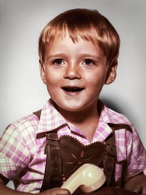

Robert Birming has launched a fourth monthly wordplay to encourage people to blog. After [Junited](/post/Junited-2026/), [JulyReply](/notes/2026/Re-JulyReply-2026-a-blog-connecting-month/), and [AuguStory](/post/AuguStory-The-story-of-my-blog/), it's now **Knowember…** and yes, I'm participating so the series doesn't get interrupted. Well played, Robert ;)

> Now in November it's time to actually get to know each other, so say hello to Knowember. The idea is simple: one page to let others know a bit more about yourself.

There will be a new edition every year, and for 2026, there are four simple "questions" ...

<!-- more -->

---

### A photo

### Name or nickname

Actually, I don't have one. Everyone calls me Kristof. When I'm out on the road, people sometimes call me 'idiot' or 'asshole.' In my relationship, I'm often called 'sweetie' or, yes, 'idiot' as well. My ex-father-in-law was the only one who, many, many moons ago, started calling me 'Kiko', a short form commonly used in parts of North Rhine-Westphalia, and that name, as nicely short and catchy it is, lives on today solely in the name of this website.

### Where in the world you blog from

How did I put it on my [About](/about) page? "*... from the lovely snoring Wiesbaden, in sometimes too hot and most times to cold Germany.*"

Here I was born, here I live, and here I will be laid to my final rest. There are more beautiful places in the world, especially those by the water, but Wiesbaden is home, and nothing can replace it.

### What your blog is mostly about

An interesting actual question, because I'm currently writing about the history of the photos on this blog, as what started out as a mere accessory, is taking up more and more space, and not just in terms of time. The IndieWeb, the Fediverse, web development, and the like always provide material for a post, but in recent months, the focus has mainly been on photos... and football, as a latecomer fan of [SV Wehen-Wiesbaden](https://svww.de).

---


url: https://robertbirming.com/knowember/
title: "Knowember, get to know your blogger"
description: "Knowember is a November blogging event where everyone answers the same questions on their own blog. One photo, three questions, low pressure. Join any time in November."
host: robertbirming.com
image: https://bear-images.sfo2.cdn.digitaloceanspaces.com/robert/knowember-og.png


 Robert even has a page you can explore the participating blogs ...


url: https://robertbirming.com/knowember-browser
title: "Knowember browser"
description: "Browse every Knowember page in one place. Step through them all, shuffle to a random blogger, or pick a country."
host: robertbirming.com
image: https://bear-images.sfo2.cdn.digitaloceanspaces.com/robert/knowember-browser-og.png
